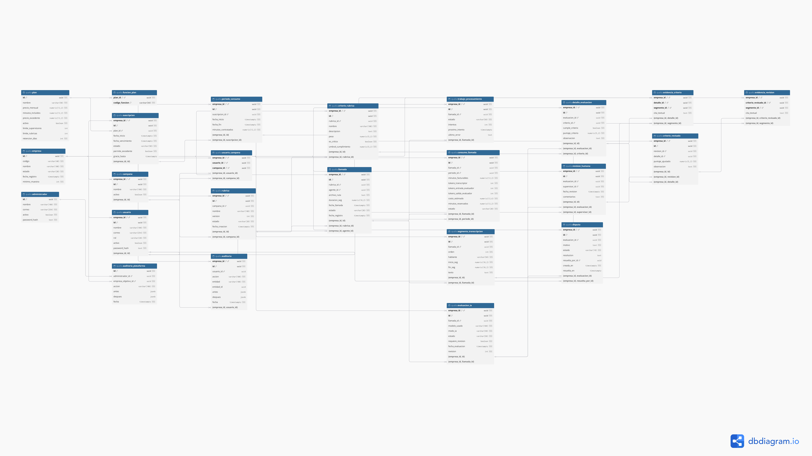

# Proyecto Final: Qualia
## Fase 1: Ideación, Análisis y Gobierno Ágil (15%)

**Plataforma SaaS multiempresa de evaluación de calidad de conversaciones con inteligencia artificial**

**Asignatura:** IS-305 Programación Web
**Sección:** 1500  
**Integrantes:** Brayan Pinel, Jonathan Ordoñez, Javier Flores, Marcel Euceda  
**Docente:** CONSTANTINO SORTO REYES

> **Alcance de esta entrega:** definición del producto, análisis, diseño de datos, organización ágil y contratos de interfaz.

---

## 1. Visión Global y Enunciado del Proyecto

### 1.1 Definición del SaaS — Pitch de una página

**Qualia: la IA propone, el humano decide.**

Los centros de contacto necesitan evaluar la calidad de sus conversaciones para identificar errores, verificar el cumplimiento de sus procedimientos y mejorar la atención. Sin embargo, escuchar y calificar llamadas manualmente consume tiempo y limita la cantidad de conversaciones revisadas. Además, cuando la retroalimentación llega sin evidencia concreta, resulta difícil explicar una calificación y orientar al agente sobre cómo mejorar.

**Qualia** es una plataforma web SaaS B2B dirigida a centros de contacto pequeños y medianos, equipos de soporte, ventas y cobranza. Cada empresa dispone de un espacio privado donde administra sus usuarios, campañas y criterios de calidad. La empresa es quien contrata la suscripción; sus supervisores y agentes utilizan el sistema como usuarios de esa organización.

La plataforma parte de grabaciones ficticias precargadas, las transcribe, enmascara datos sensibles en el texto y genera un borrador de evaluación mediante inteligencia artificial. La evaluación utiliza una rúbrica configurable y versionada por campaña. Cada criterio puede vincularse con un segmento de la transcripción y con el instante correspondiente del audio, lo que permite al supervisor revisar la evidencia sin escuchar nuevamente toda la conversación.

El valor central es combinar automatización con control humano. **Una evaluación generada por IA no se convierte automáticamente en una calificación oficial.** El supervisor confirma o ajusta los resultados y sus cambios quedan registrados. El agente puede consultar sus evaluaciones y presentar una disputa. El sistema ofrece evidencia para apoyar la mejora del desempeño; no toma decisiones disciplinarias automáticas.

Las evaluaciones validadas alimentan un scorecard individual con puntaje, resultados por criterio y seguimiento del agente. Las funciones de tendencia, comparación por campaña y disputas se habilitan según el plan. Solo se muestran promedios oficiales cuando existe una cantidad mínima de llamadas confirmadas, y las evaluaciones con disputas abiertas se excluyen temporalmente del cálculo.

El modelo comercial consiste en una suscripción mensual por empresa con minutos de audio incluidos y límites de uso. Los planes propuestos son Básico, Pro y Enterprise. El consumo por minuto permite relacionar el servicio ofrecido con el volumen de conversaciones procesadas. Para el proyecto académico, el cobro se simula y se utilizan audios ficticios. El modo de IA simulado permite demostrar el flujo completo sin depender de créditos de proveedores.

Qualia se diferencia por ofrecer evidencia verificable en audio, rúbricas propias por campaña, revisión humana obligatoria y separación de datos entre empresas. Su objetivo es ampliar la cobertura de revisión de las llamadas precargadas y reducir el trabajo repetitivo de los supervisores, manteniendo trazabilidad, acceso por roles y retroalimentación útil para cada agente.

### 1.2 Objetivo general

Diseñar una plataforma SaaS multiempresa para gestionar la evaluación de calidad de llamadas mediante rúbricas configurables, asistencia de IA y validación humana, garantizando el aislamiento de los datos de cada empresa.

### 1.3 Objetivos específicos

- Definir el alcance del MVP y los permisos de sus actores.
- Modelar la información en tercera forma normal, con `EmpresaId` en todas las tablas propias de una empresa.
- Establecer reglas para procesar llamadas, revisar resultados y calcular el desempeño individual.
- Organizar el trabajo en épicas e historias de usuario verificables mediante GitHub Projects.
- Definir endpoints y DTOs de entrada y salida antes de iniciar la construcción.

### 1.4 Objetivo académico y enfoque de trabajo

Se sigue la estructura introductoria del proyecto trabajado en clases: visión global, MVP, épicas e historias de usuario. Se adopta su enfoque API-First, separación por capas, contratos DTO y organización por funcionalidades. A esa base se agregan los requisitos específicos de la fase 1: modelo multiempresa, ERD normalizado y planificación del tablero.

| Área | Decisión de diseño para las fases posteriores |
|---|---|
| Backend | C#/.NET con Domain, Application, Infrastructure y API |
| Organización | Vertical Slicing por funcionalidades |
| Frontend | React y TypeScript; formularios con React Hook Form y Zod |
| Persistencia | PostgreSQL y Entity Framework Core |
| Seguridad | Autenticación JWT y autorización por roles y recursos |
| Integraciones | Interfaces para transcripción, evaluación, almacenamiento y pagos simulados |

---

##  2. Definición del Producto Mínimo Viable (MVP)

### 2.1 Funcionalidades incluidas

1. Registro de empresa y administrador inicial, con selección de plan y suscripción simulada.
2. Inicio de sesión, gestión de usuarios y permisos por rol.
3. Gestión de campañas y asignación de agentes y supervisores.
4. Rúbricas versionadas con criterios, pesos e indicadores críticos.
5. Selección de llamadas ficticias precargadas por empresa y campaña, inicio de su evaluación y consulta del estado.
6. Procesamiento asíncrono: transcripción, enmascarado, evaluación y validación de evidencia.
7. Consulta de transcripción y reproducción del fragmento asociado a un criterio.
8. Confirmación o ajuste humano, con registro de los cambios.
9. Disputas y scorecards, respetando las funciones del plan.
10. Consulta de suscripción y consumo; bloqueo de nuevas evaluaciones cuando corresponda.
11. Administración comercial por PlatformAdmin, sin acceso al contenido de llamadas.
12. Modo simulado de IA y planificación de verificaciones de aislamiento.

**Restricción académica:** se prioriza el recorrido completo con IA y pagos simulados. La integración real de IA se mantiene desacoplada y no se presenta como gratuita. El diseño de esta fase no depende de contratar máquinas virtuales, dominios ni servicios pagados; el despliegue se resolverá en la fase 5 conforme a la consigna de costo cero.

### 2.2 Fuera del MVP

Carga manual de audios, integración real con centrales telefónicas, webhooks de producción, carga masiva por SFTP, pagos reales, evaluación en tiempo real, soporte multilingüe, búsqueda semántica, prioridad de procesamiento por plan, purga automática y retención diferenciada, y decisiones disciplinarias automáticas.

### 2.3 Actores y permisos

| Rol | Responsabilidades | Restricción principal |
|---|---|---|
| PlatformAdmin | Consultar empresas, catálogo de planes y consumo; cambiar suscripciones mediante el flujo simulado | Sin acceso a audios, transcripciones ni evaluaciones individuales |
| AdminEmpresa | Gestionar usuarios, campañas, rúbricas, asignaciones y suscripción; consultar resultados | Solo su empresa; no confirma evaluaciones por este rol |
| Supervisor | Seleccionar llamadas precargadas, revisar evidencia, confirmar o ajustar y resolver disputas | Solo campañas asignadas |
| Agente | Consultar sus llamadas, calificaciones y scorecard; abrir disputas | Solo información propia |
| Auditor | Consultar reportes agregados | Solo su empresa; sin audio ni scorecards individuales |

Para el MVP se adopta la restricción más específica del documento base para Auditor: reportes agregados. No se habilita la consulta de evaluaciones individuales.

### 2.4 Planes y suscripción

| Plan propuesto | Minutos mensuales | Supervisores | Rúbricas activas | Funciones |
|---|---:|---:|---:|---|
| Básico | 1,000 | 2 | 1 | Evaluación y scorecard básico |
| Pro | 5,000 | 10 | Sin límite | Básico más tendencia, comparación y disputas |
| Enterprise | 20,000 | Sin límite | Sin límite | Funciones Pro con mayor cuota y sin límite de supervisores |

Los valores son propuestas del documento de Qualia, no tarifas verificadas de servicios externos. La prioridad de procesamiento y la retención diferenciada por plan quedan como mejoras futuras; no son compromisos del MVP. Durante la demostración se conservan los audios ficticios y sus resultados. `Plan.retencion_dias` se configura inicialmente en 365 para todos los planes como parámetro previsto para la futura política de retención; el MVP no implementa purga automática.

| Estado | Regla de acceso |
|---|---|
| Prueba | Permite operar dentro de la cuota de prueba |
| Activa | Permite operar según el plan |
| EnMora | Permite consulta; bloquea nuevas evaluaciones |
| Vencida | Permite consulta durante el periodo de gracia configurado; bloquea el inicio de evaluaciones |

El backend consulta el estado vigente y los límites antes de iniciar una evaluación. Los permisos comerciales no dependen exclusivamente de información potencialmente desactualizada del JWT.

### 2.5 Reglas de negocio principales

| ID | Regla |
|---|---|
| RN-01 | Toda operación empresarial se ejecuta dentro de la empresa autenticada. |
| RN-02 | El email es único dentro de cada empresa; el login identifica empresa y credenciales. |
| RN-03 | La campaña, el agente, la rúbrica y la llamada deben pertenecer a la misma empresa. El agente debe estar asignado a la campaña. |
| RN-04 | Una rúbrica publicada es inmutable. Cada cambio crea una versión nueva; una campaña tiene como máximo una versión activa. |
| RN-05 | Los pesos de los criterios son positivos y suman 100 al publicar. Cada nota está entre 0 y 100. |
| RN-06 | El total se calcula como suma de `nota × peso / 100`. Los fallos críticos se reportan aparte; no provocan una sanción automática. |
| RN-07 | La llamada conserva la versión de rúbrica seleccionada al ingresar, aunque después cambie la versión activa de la campaña. |
| RN-08 | El servidor calcula notas totales y consumo. El cliente no puede fijarlos. |
| RN-09 | Una cita debe existir en un segmento de la misma llamada. Los tiempos provienen del segmento, nunca de la generación del LLM. |
| RN-10 | La ausencia de evidencia se representa explícitamente. Una evaluación con evidencia inválida exige revisión humana antes de oficializarse. |
| RN-11 | Solo las evaluaciones confirmadas o ajustadas, sin disputa abierta, cuentan en el promedio oficial. El mínimo se obtiene de Empresa.minimo_muestra, predeterminado en 5: por agente, campaña y periodo para el scorecard individual, y por campaña y periodo para el agregado. |
| RN-12 | Cada ajuste exige motivo; se conserva el resultado propuesto por IA y el resultado humano. |
| RN-13 | El inicio de la evaluación reserva minutos de forma atómica; los reintentos del mismo trabajo no duplican la reserva ni el consumo facturable. |
| RN-14 | Solo se usan audios ficticios en la demostración. La transcripción se enmascara antes de almacenarse y enviarse al evaluador. |

---

## 3. Épicas del Sistema (Epics)

| Épica | Nombre | Alcance |
|---|---|---|
| EP-01 | Identidad y seguridad | Empresa, login, roles, usuarios y aislamiento |
| EP-02 | Administración comercial | Planes, suscripciones y límites |
| EP-03 | Campañas y rúbricas | Campañas, asignaciones y versiones de evaluación |
| EP-04 | Motor de evaluación | Selección de llamadas, cola, transcripción y evaluación asistida |
| EP-05 | Revisión humana | Evidencia, confirmación, ajustes y disputas |
| EP-06 | Desempeño individual | Scorecard y resultados por campaña |

---

## 4. Historias de Usuario (User Stories — HUs)

**P0:** indispensable para el recorrido principal. **P1:** necesario para completar el MVP. Los criterios de cada historia son específicos; la Definition of Done común se define en la sección 5.

### EP-01: Identidad y seguridad

**HU-01 — Registro de empresa · P0**  
*Como* AdminEmpresa, *quiero* registrar mi empresa y elegir un plan, *para* obtener un espacio privado.

- Se crean empresa, usuario inicial con rol AdminEmpresa y suscripción de prueba en una sola transacción. Este usuario pertenece a Usuario; no se crea un Administrador global.
- El código de empresa es único; la contraseña se guarda como hash.
- Un error revierte toda la operación; no quedan empresas parcialmente registradas.

**HU-08 — Aislamiento entre empresas · P0**  
*Como* responsable técnico, *quiero* verificar el aislamiento, *para* impedir acceso cruzado a información.

- Un usuario de empresa A recibe 404 al consultar o modificar un recurso de B.
- Se verifica aislamiento en listados, detalle, audio, reportes y procesamiento en segundo plano.
- Una relación entre registros de empresas diferentes se rechaza también mediante integridad referencial.

**HU-11 — Inicio de sesión · P0**  
*Como* usuario, *quiero* iniciar sesión con mi empresa, email y contraseña, *para* acceder a mis funciones.

- Credenciales válidas generan un token con usuario, rol y empresa; inválidas devuelven 401 sin revelar cuál dato falló.
- El rol Agente no puede invocar operaciones de Supervisor.
- PlatformAdmin utiliza acceso separado y no recibe permisos sobre contenidos empresariales.

**HU-12 — Usuarios y asignaciones · P0**  
*Como* AdminEmpresa, *quiero* administrar usuarios y asignarlos a campañas, *para* delimitar responsabilidades.

- Email único por empresa; un administrador empresarial no puede crear PlatformAdmin.
- La asignación solo admite usuarios de la misma empresa y roles Agente o Supervisor.
- Se respetan los límites de supervisores del plan y no se puede desactivar al último administrador activo.

### EP-02: Administración comercial

**HU-06 — Control del plan · P0**  
*Como* responsable de la empresa, *quiero* que el sistema valide mi plan antes de procesar llamadas, *para* controlar el consumo contratado.

- EnMora y Vencida bloquean nuevas evaluaciones con un error de negocio identificable.
- Se comprueba cuota disponible, reserva de minutos y permiso de excedente.
- Dos solicitudes simultáneas no pueden consumir el mismo saldo disponible.

**HU-07 — Administración de plataforma · P1**  
*Como* PlatformAdmin, *quiero* consultar empresas, planes y consumo, *para* gestionar el servicio.

- Puede consultar datos comerciales y cambiar la suscripción mediante el flujo simulado.
- No puede acceder a audio, transcripción o evaluación de ningún agente.
- Los cambios comerciales quedan registrados con actor, fecha y valores modificados.

### EP-03: Campañas y rúbricas

**HU-02 — Campañas y rúbricas versionadas · P0**  
*Como* AdminEmpresa, *quiero* crear campañas y sus rúbricas, *para* definir cómo evaluar las conversaciones.

- Cada rúbrica incluye nombre, versión y criterios con descripción, peso y marca crítica.
- Solo se publica si los pesos suman 100 y no hay nombres de criterio duplicados dentro de la versión.
- Una nueva versión no altera resultados históricos; no se borra una rúbrica ya utilizada.

### EP-04: Motor de evaluación

**HU-13 — Procesamiento asistido por IA · P0**  
*Como* Supervisor, *quiero* recibir un borrador con evidencia, *para* concentrarme en la revisión.

- Se transcribe, enmascara texto y evalúa con la versión fijada al ingresar la llamada.
- Se validan notas, criterios, segmentos y citas. La evidencia inválida se marca para revisión.
- Los fallos tienen reintentos limitados y motivo visible; el modo simulado produce resultados reproducibles y se identifica como tal.

### EP-05: Revisión humana

**HU-03 — Consulta de evaluación y evidencia · P0**  
*Como* Supervisor, *quiero* ver la evaluación y escuchar el fragmento de cada criterio, *para* verificar la nota.

- La consulta muestra notas, justificaciones, estado y evidencia por criterio.
- Seleccionar una evidencia posiciona el reproductor en el tiempo del segmento correspondiente.
- La autorización se valida antes de emitir acceso temporal al audio; el acceso queda registrado.

**HU-04 — Confirmación o ajuste · P0**  
*Como* Supervisor, *quiero* confirmar o corregir una evaluación, *para* conservar la decisión humana.

- La acción Confirmar constituye la declaración del supervisor de haber revisado todos los criterios; no se registra una marca de lectura por criterio. El servidor comprueba que la evaluación esté completa y que no conserve evidencias inválidas antes de oficializarla.
- Un ajuste exige motivo y notas válidas; el total se recalcula en el servidor.
- Se conserva el resultado de IA y se audita el cambio. Una revisión concurrente desactualizada devuelve 409.

**HU-05 — Consulta propia y disputa · P1**  
*Como* Agente, *quiero* consultar y disputar mis evaluaciones, *para* solicitar una revisión fundamentada.

- Solo puede consultar sus evaluaciones y disputar una oficial si su plan lo permite.
- Solo puede existir una disputa abierta por evaluación; el motivo es obligatorio.
- El Supervisor resuelve con justificación; si modifica notas, se auditan. La disputa abierta excluye temporalmente la evaluación del promedio.

### EP-06: Desempeño individual

**HU-09 — Scorecard del agente · P1**  
*Como* Agente, *quiero* consultar mi puntaje y resultados por criterio, *para* identificar mejoras.

- Usa solo evaluaciones oficiales sin disputa abierta, filtradas por campaña y periodo.
- Con menos llamadas elegibles que el mínimo configurado para la empresa (5 de forma predeterminada), por agente, campaña y periodo, muestra cantidad y “muestra insuficiente”, sin promedio oficial.
- Tendencia compara periodos equivalentes cuando el plan lo permite; no mezcla criterios de versiones distintas sin identificarlos.

**HU-10 — Desempeño del equipo · P1**  
*Como* Supervisor, *quiero* consultar el desempeño de mi equipo, *para* dar seguimiento.

- Solo consulta agentes de campañas asignadas y funciones permitidas por el plan.

---

## 5. Gobierno Ágil y Tablero Kanban

### 5.1 Configuración propuesta en GitHub Projects

**Nombre:** Qualia — Proyecto Final.  
**Vista:** Board.  
**Columnas:** Backlog, Listo, En progreso, En revisión y Hecho.

| Columna | Condición |
|---|---|
| Backlog | Trabajo identificado y pendiente de priorización |
| Listo | Alcance, criterios, dependencias y responsable definidos |
| En progreso | Trabajo iniciado por su responsable |
| En revisión | Entregable disponible para revisión de otro integrante |
| Hecho | Criterios de aceptación y DoD satisfechos con evidencia |

**Campos:** ID, épica, prioridad, responsable, fase, estado y enlace a evidencia.  
**Etiquetas:** `analisis`, `datos`, `api`, `backend`, `frontend`, `seguridad`, `ia`, `qa`.  
**Límite de trabajo en curso propuesto:** una tarea en progreso por integrante.  
**Dinámica:** revisión breve del tablero en cada sesión de trabajo; bloqueos y dependencias se registran en la tarjeta.

### 5.2 Dependencias del backlog

| Historias | Dependencias principales |
|---|---|
| HU-01, HU-11 | Base de identidad y modelo de empresa |
| HU-12 | HU-01, HU-11 |
| HU-02 | HU-12 |
| HU-06, HU-07 | HU-01, HU-11 |
| HU-13 | HU-02, HU-06, HU-12 |
| HU-03, HU-04 | HU-13 |
| HU-05 | HU-04 |
| HU-09, HU-10 | HU-04, HU-05 |
| HU-08 | Transversal; se verifica con cada funcionalidad |

### 5.3 Definition of Done

**Para las tarjetas de análisis:** artefacto redactado, sin contradicciones entre modelo y contratos, criterios verificables, revisión por otro integrante y evidencia vinculada en GitHub Projects.

**Para las historias de implementación posteriores:** criterios cumplidos; solución compilable; validaciones y permisos comprobados; aislamiento verificado; contrato y documentación actualizados; peticiones verificadas en Scalar o archivos `.http`; revisión por otro integrante. Estos requisitos se planifican aquí, no se presentan como ya ejecutados.

### 5.4 Enlaces del proyecto

**URL del repositorio:** https://github.com/BrayanPinel/Qualia  
**URL de GitHub Projects:** https://github.com/users/BrayanPinel/projects/2

---

## 6. Diseño Multiempresa y Modelo de Datos en 3FN

### 6.1 Aislamiento y claves

En PostgreSQL, `empresa_id` corresponde a `EmpresaId` de la consigna. Es FK a **Empresa** en cada tabla empresarial. **Empresa**, **Plan** y **Administrador** tienen PK simple `id`. **Funcion_plan** tiene PK (`plan_id`, `codigo_funcion`) y **Auditoria_plataforma** tiene PK simple `id`; ambas son globales. Las demás usan PK compuesta por `empresa_id` e `id`, salvo **Usuario_campana** (`empresa_id`, `usuario_id`, `campana_id`), **Evidencia_criterio** (`empresa_id`, `detalle_id`, `segmento_id`) y **Evidencia_revision** (`empresa_id`, `criterio_revisado_id`, `segmento_id`). Las FK entre registros empresariales incluyen la empresa. El API toma la empresa de la sesión y el trabajador de procesamiento la toma del trabajo en cola.

### 6.2 Diccionario del diagrama relacional

El modelo corregido contiene 24 tablas y corresponde a la estructura de la tercera versión del diagrama relacional. Todos los identificadores son UUID; `codigo_funcion` es un código de texto. Se conserva la referencia de imagen de 6.3; para la entrega, el archivo `diagrama_base_de_datos.jpeg` debe contener la exportación del diagrama actualizado. La cardinalidad de un único trabajo, consumo y evaluación por llamada queda definida por las restricciones de 6.4 y 6.5, aunque el dibujo importado muestre múltiples hijos. En **Segmento_transcripcion**, el campo `texto` contiene la transcripción enmascarada.

| Tabla | Columnas y tipos PostgreSQL |
|---|---|
| Plan | `id` uuid, `nombre` varchar(50), `precio_mensual` numeric(12,2), `minutos_incluidos` numeric(12,2), `precio_excedente` numeric(12,2), `activo` boolean, `limite_supervisores` int NULL, `limite_rubricas` int NULL, `retencion_dias` int |
| Empresa | `id` uuid, `codigo` varchar(40), `nombre` varchar(100), `estado` varchar(20), `fecha_registro` timestamptz, `minimo_muestra` int DEFAULT 5 |
| Administrador | `id` uuid, `nombre` varchar(100), `correo` varchar(254), `activo` boolean, `password_hash` text |
| Suscripcion | `empresa_id` uuid, `id` uuid, `plan_id` uuid, `fecha_inicio` timestamptz, `fecha_vencimiento` timestamptz, `estado` varchar(50), `permite_excedente` boolean DEFAULT false, `gracia_hasta` timestamptz NULL |
| Periodo_consumo | `empresa_id` uuid, `id` uuid, `suscripcion_id` uuid, `fecha_inicio` timestamptz, `fecha_fin` timestamptz, `minutos_contratados` numeric(12,2) |
| Usuario | `empresa_id` uuid, `id` uuid, `nombre` varchar(100), `correo` varchar(254), `rol` varchar(20), `activo` boolean, `password_hash` text |
| Campana | `empresa_id` uuid, `id` uuid, `nombre` varchar(100), `activo` boolean |
| Usuario_campana | `empresa_id` uuid, `usuario_id` uuid, `campana_id` uuid |
| Rubrica | `empresa_id` uuid, `id` uuid, `campana_id` uuid, `nombre` varchar(100), `version` int, `estado` varchar(20), `fecha_creacion` timestamptz |
| Criterio_rubrica | `empresa_id` uuid, `id` uuid, `rubrica_id` uuid, `nombre` varchar(100), `descripcion` text, `peso` numeric(5,2), `es_critico` boolean, `umbral_cumplimiento` numeric(5,2) |
| Llamada | `empresa_id` uuid, `id` uuid, `rubrica_id` uuid, `agente_id` uuid, `archivo_ruta` text, `duracion_seg` numeric(10,2), `fecha_llamada` timestamptz, `estado` varchar(20), `fecha_registro` timestamptz |
| Trabajo_procesamiento | `empresa_id` uuid, `id` uuid, `llamada_id` uuid, `estado` varchar(50), `intentos` int, `proximo_intento` timestamptz, `ultimo_error` text |
| Consumo_llamada | `empresa_id` uuid, `id` uuid, `llamada_id` uuid, `periodo_id` uuid, `minutos_facturables` numeric(12,2), `tokens_transcriptor` int, `tokens_entrada_evaluador` int, `tokens_salida_evaluador` int, `costo_estimado` numeric(12,6), `minutos_reservados` numeric(12,2) DEFAULT 0, `estado` varchar(20) |
| Segmento_transcripcion | `empresa_id` uuid, `id` uuid, `llamada_id` uuid, `orden` int, `hablante` varchar(50), `inicio_seg` numeric(10,2), `fin_seg` numeric(10,2), `texto` text |
| Evaluacion_IA | `empresa_id` uuid, `id` uuid, `llamada_id` uuid, `modelo_usado` varchar(100), `modo_ia` varchar(50), `estado` varchar(50), `requiere_revision` boolean, `fecha_evaluacion` timestamptz, `revision` int DEFAULT 1 |
| Detalle_evaluacion | `empresa_id` uuid, `id` uuid, `evaluacion_id` uuid, `criterio_id` uuid, `cumple_criterio` boolean, `puntaje_criterio` numeric(5,2), `observacion` text |
| Evidencia_criterio | `empresa_id` uuid, `detalle_id` uuid, `segmento_id` uuid, `cita_textual` text |
| Revision_humana | `empresa_id` uuid, `id` uuid, `evaluacion_id` uuid, `supervisor_id` uuid, `fecha_revision` timestamptz, `comentarios` text |
| Criterio_revisado | `empresa_id` uuid, `id` uuid, `revision_id` uuid, `detalle_id` uuid, `puntaje_ajustado` numeric(5,2), `observacion` text |
| Funcion_plan | `plan_id` uuid, `codigo_funcion` varchar(50) |
| Disputa | `empresa_id` uuid, `id` uuid, `evaluacion_id` uuid, `motivo` text, `estado` varchar(10), `resolucion` text NULL, `resuelta_por_id` uuid NULL, `creada_en` timestamptz, `resuelta_en` timestamptz NULL |
| Auditoria | `empresa_id` uuid, `id` uuid, `usuario_id` uuid NULL, `accion` varchar(100), `entidad` varchar(100), `entidad_id` uuid NULL, `antes` jsonb NULL, `despues` jsonb NULL, `fecha` timestamptz |
| Auditoria_plataforma | `id` uuid, `administrador_id` uuid, `empresa_objetivo_id` uuid, `accion` varchar(100), `antes` jsonb NULL, `despues` jsonb NULL, `fecha` timestamptz |
| Evidencia_revision | `empresa_id` uuid, `criterio_revisado_id` uuid, `segmento_id` uuid, `cita_textual` text |

Todos los campos son `NOT NULL`, excepto los marcados `NULL` y `Trabajo_procesamiento.proximo_intento` y `ultimo_error`, que admiten NULL. Los límites de plan NULL significan sin límite; las credenciales se almacenan únicamente como hash. Los campos de resolución de una disputa permanecen NULL mientras esté abierta.

### 6.3 Diagrama entidad–relación

La raíz Empresa se relaciona con cada tabla que incluye `empresa_id`. El diagrama detalla las demás referencias. Las restricciones de unicidad del MVP limitan a uno el número de trabajos, evaluaciones y cargos asociados a cada llamada.



### 6.4 Normalización, restricciones e índices requeridos

- **1FN.** Cada segmento, evidencia y criterio revisado tiene su propia fila.
- **2FN.** Una asignación usuario–campaña se identifica por su clave completa. La cita de una evidencia pertenece al par detalle–segmento dentro de la empresa.
- **3FN.** Llamada identifica la rúbrica y desde ella se obtiene la campaña. Las notas de IA se guardan en Detalle_evaluacion y los ajustes de cada supervisor en Criterio_revisado. Los totales y scorecards se calculan a partir de esos hechos.
- **Unicidad por empresa.** Definir claves únicas para correo normalizado, versión por campaña, criterio por evaluación, orden de segmento por llamada y ajuste de un detalle por revisión. Permitir una sola rúbrica activa por campaña y un solo trabajo, evaluación y consumo por llamada.
- **Integridad.** Validar que la rúbrica del criterio coincida con la de la llamada, que la evidencia provenga de esa llamada y que el detalle revisado corresponda a la evaluación de la revisión. Verificar pesos positivos que sumen 100 al publicar, notas entre 0 y 100 e intervalos de audio dentro de la duración registrada.
- **Índices de consulta.** Llamada(empresa_id, estado, rubrica_id), Revision_humana(empresa_id, evaluacion_id, fecha_revision) y Trabajo_procesamiento(estado, proximo_intento).

### 6.5 Reglas de persistencia y correspondencia con los contratos

Los datos necesarios para las historias vigentes quedan integrados en 6.2; no son ampliaciones aplazadas.

- **Aislamiento.** Cada FK empresarial utiliza `(empresa_id, id_referenciado)` hacia la PK del padre; todos los `empresa_id` son FK a Empresa. Las FK deben implementarse en PostgreSQL, junto con filtros por empresa y autorización por recurso. No basta con mostrar las claves en el dibujo.
- **Relaciones y nulabilidad.** Cada hijo con FK obligatoria tiene exactamente un padre; el padre puede tener cero o varios hijos. Trabajo_procesamiento, Evaluacion_IA y Consumo_llamada son excepciones: cada llamada tiene cero o uno de cada uno, mediante UNIQUE (`empresa_id`, `llamada_id`). Una auditoría puede no tener usuario cuando la acción la ejecuta el sistema; una disputa abierta no tiene supervisor resolutor.
- **Unicidad.** Empresa.codigo y Administrador.correo son únicos globalmente. Se normalizan código y correos antes de guardar. Usuario tiene UNIQUE (`empresa_id`, `correo`); Rubrica, (`empresa_id`, `campana_id`, `version`); Detalle_evaluacion, (`empresa_id`, `evaluacion_id`, `criterio_id`); Segmento_transcripcion, (`empresa_id`, `llamada_id`, `orden`); Criterio_revisado, (`empresa_id`, `revision_id`, `detalle_id`). Índices únicos parciales permiten una rúbrica Activa por campaña, una suscripción vigente por empresa (estado Prueba, Activa o EnMora) y una disputa Abierta por evaluación. El cambio de plan cierra la suscripción anterior y crea la nueva en una transacción, sujeto a las restricciones del periodo descritas en 7.8; otros cambios comerciales no duplican la suscripción.
- **Reservas.** Al encolar se reserva duración/60, redondeada hacia arriba a dos decimales según 7.8, contra el periodo bajo bloqueo transaccional. Consumo_llamada nace en Reservado; al completar pasa a Facturado, mueve los minutos reservados a facturables y deja la reserva en cero. Ante fallo definitivo pasa a Liberado y deja ambos importes en cero. Un reintento conserva el mismo consumo para evitar doble cobro; el costo técnico se acumula por llamada incluso si falla.
- **Concurrencia.** Evaluacion_IA.revision comienza en 1. Confirmar, ajustar o resolver una disputa compara `revisionEsperada` y aumenta la revisión atómicamente; una discrepancia devuelve 409. Los ajustes y sus evidencias se guardan en Revision_humana, Criterio_revisado y Evidencia_revision, preservando los resultados originales.
- **Llamada y campaña.** La precarga asigna una rúbrica publicada e inmutable y un agente de su campaña. `campanaId` y `versionRubrica` se obtienen mediante Rubrica; no se añade una segunda FK de campaña a Llamada. Cambiar la rúbrica activa no modifica llamadas anteriores.
- **Restricciones de valores.** Pesos positivos y suma 100 al publicar; umbrales y notas entre 0 y 100; minutos, tokens y costos no negativos; revisión y mínimo de muestra mayores que cero; límites de plan y retención positivos cuando correspondan. `gracia_hasta`, si existe, no precede al vencimiento. Validar estados con CHECK y aplicar las transiciones en la capa de aplicación.
- **Disputas y auditoría.** Una disputa Resuelta exige resolución, supervisor y fecha; una Abierta no los tiene. `resuelta_por_id` referencia Usuario de la misma empresa y se valida su rol y campaña. Auditoria.usuario_id referencia Usuario de la misma empresa; `entidad_id` es una referencia lógica al recurso indicado por `entidad`, no una FK polimórfica. Auditoria_plataforma referencia Administrador y Empresa; no concede acceso a contenido de llamadas. No se guardan contraseñas, tokens ni secretos en los JSON de auditoría.
- **DTOs calculados.** Los saldos se obtienen del periodo y sus consumos; los puntajes vigentes se obtienen del último ajuste humano aplicable o de la propuesta original; totales y scorecards se calculan. `motivoFallo` procede del último error de procesamiento, saneado para no exponer datos internos. Las funciones del plan se consultan en Funcion_plan y el mínimo de muestra en Empresa. No se requieren columnas duplicadas para cada propiedad de salida.

##  7. Contratos de Interfaz: API-First

### 7.1 Convenciones

- Prefijo `/api`; JSON en `camelCase`.
- La API obtiene `empresaId` del JWT validado y lo aplica a las consultas y escrituras empresariales. Cada búsqueda por ID comprueba también la empresa y los permisos del usuario. Un recurso de otra empresa devuelve 404. En las rutas de administración global, PlatformAdmin indica la empresa objetivo en la ruta.
- Fechas de instante en ISO 8601 UTC; periodo de scorecard como `YYYY-MM`.
- Listados paginados: `pagina` desde 1 y `tamanoPagina` de 1 a 100; predeterminado 20.
- Campos desconocidos de entrada se rechazan. No se aceptan entidades de dominio directamente.
- Las respuestas nunca incluyen hashes, credenciales de proveedores ni rutas internas del almacenamiento.
- Token Bearer en rutas privadas. La protección de confidencialidad del claim exigida por la consigna debe definirse al implementar: un JWT firmado por sí solo no cifra su contenido; si se exige cifrado se utilizará JWE.
- Cada política valida rol, empresa, asignación a campaña, propietario y función de plan, según corresponda.

### 7.2 Endpoints de identidad y administración

| Método y ruta | Acceso | Entrada | Salida exitosa |
|---|---|---|---|
| GET /api/planes | Público | Sin cuerpo | 200 PlanDto[] |
| POST /api/empresas | Público | RegistrarEmpresaDto | 201 EmpresaRegistradaDto |
| POST /api/auth/login | Público | LoginDto | 200 SesionDto |
| POST /api/plataforma/auth/login | Público | LoginPlataformaDto | 200 SesionPlataformaDto |
| GET /api/usuarios | AdminEmpresa | Paginación | 200 PaginaDto<UsuarioDto> |
| POST /api/usuarios | AdminEmpresa | CrearUsuarioDto | 201 UsuarioDto |
| PUT /api/usuarios/{id} | AdminEmpresa | ActualizarUsuarioDto | 204 |
| GET /api/suscripcion | AdminEmpresa | Sin cuerpo | 200 SuscripcionDto |
| GET /api/consumo?periodo=YYYY-MM | AdminEmpresa | Periodo | 200 ConsumoDto |
| POST /api/suscripcion/pago-simulado | AdminEmpresa | PagoSimuladoDto | 200 SuscripcionDto |
| GET /api/plataforma/empresas | PlatformAdmin | Paginación | 200 PaginaDto<EmpresaComercialDto> |
| PUT /api/plataforma/empresas/{empresaId}/suscripcion | PlatformAdmin | CambiarSuscripcionDto | 200 SuscripcionDto |

### 7.3 Endpoints de campañas y rúbricas

| Método y ruta | Acceso | Entrada | Salida exitosa |
|---|---|---|---|
| GET /api/campanas | AdminEmpresa; Supervisor; Agente; Auditor | Paginación; alcance filtrado por rol y empresa | 200 PaginaDto<CampanaDto> |
| POST /api/campanas | AdminEmpresa | GuardarCampanaDto | 201 CampanaDto |
| PUT /api/campanas/{id} | AdminEmpresa | GuardarCampanaDto | 204 |
| GET /api/campanas/{id}/usuarios | AdminEmpresa | Paginación | 200 PaginaDto<UsuarioDto>; solo asignados a esa campaña |
| PUT /api/campanas/{id}/usuarios/{usuarioId} | AdminEmpresa | Sin cuerpo | 204; asignación idempotente |
| DELETE /api/campanas/{id}/usuarios/{usuarioId} | AdminEmpresa | Sin cuerpo | 204; revoca asignación |
| GET /api/campanas/{id}/rubricas | AdminEmpresa; Supervisor asignado | Sin cuerpo | 200 RubricaDto[] |
| POST /api/campanas/{id}/rubricas | AdminEmpresa | CrearRubricaDto | 201 RubricaDto |
| PUT /api/rubricas/{id} | AdminEmpresa | CrearRubricaDto | 204; solo borrador |
| POST /api/rubricas/{id}/publicar | AdminEmpresa | Sin cuerpo | 200 RubricaDto |

En `GET /api/campanas`, AdminEmpresa y Auditor reciben las campañas de su empresa; Supervisor recibe solo las asignadas; Agente recibe las asignadas o aquellas donde conserva llamadas propias. Esto permite seleccionar `campanaId` para reportes y scorecards. El listado no concede acceso adicional a usuarios, rúbricas, llamadas o evaluaciones: cada endpoint mantiene su política. Auditor solo puede consultar metadatos de campañas y reportes agregados.

### 7.4 Endpoints del proceso principal

| Método y ruta | Acceso | Entrada | Salida exitosa |
|---|---|---|---|
| POST /api/llamadas/{id}/evaluacion | Supervisor asignado | UUID de la llamada en la ruta, sin cuerpo | 202 EvaluacionAceptadaDto |
| GET /api/llamadas | AdminEmpresa; Supervisor asignado; Agente propietario | Paginación y filtros opcionales de campaña, agente y estado | 200 PaginaDto<LlamadaDto> |
| GET /api/llamadas/{id} | Mismos permisos de lectura | Sin cuerpo | 200 LlamadaDto |
| GET /api/llamadas/{id}/transcripcion | Mismos permisos de lectura | Sin cuerpo | 200 SegmentoDto[] |
| GET /api/llamadas/{id}/audio | Mismos permisos de lectura | Sin cuerpo | 200 AccesoAudioDto |
| GET /api/llamadas/{id}/evaluacion | Mismos permisos de lectura | Sin cuerpo | 200 EvaluacionDto |
| POST /api/evaluaciones/{id}/confirmar | Supervisor asignado | ConfirmarEvaluacionDto | 200 EvaluacionDto |
| PUT /api/evaluaciones/{id}/ajuste | Supervisor asignado | AjustarEvaluacionDto | 200 EvaluacionDto |
| POST /api/evaluaciones/{id}/disputas | Agente propietario; plan habilitado | CrearDisputaDto | 201 DisputaDto |
| GET /api/disputas | AdminEmpresa; Supervisor asignado; Agente propietario | Paginación y estado opcional | 200 PaginaDto<DisputaDto> |
| PUT /api/disputas/{id}/resolucion | Supervisor asignado | ResolverDisputaDto | 200 DisputaDto |

### 7.5 Endpoints de desempeño

| Método y ruta | Acceso | Entrada | Salida exitosa |
|---|---|---|---|
| GET /api/agentes/me/scorecard | Agente | Query: campanaId, periodo | 200 ScorecardDto |
| GET /api/agentes/{id}/scorecard | AdminEmpresa; Supervisor asignado | Query: campanaId, periodo | 200 ScorecardDto |
| GET /api/campanas/{id}/scorecards | AdminEmpresa; Supervisor asignado | Query: periodo y paginación | 200 PaginaDto<ScorecardDto> |
| GET /api/reportes/campanas/{id} | AdminEmpresa; Supervisor asignado; Auditor | Query: periodo | 200 ReporteCampanaDto agregado |

### 7.6 DTOs de entrada

La notación siguiente define campos y tipos del contrato, no implementa clases. `?` indica opcional; `[]` indica colección. `id` representa un UUID serializado como cadena. Todos los campos no marcados como opcionales son obligatorios.

```text
RegistrarEmpresaDto {
  codigoEmpresa: string, nombreEmpresa: string, planId: id,
  nombreAdministrador: string, email: string, password: string
}
LoginDto { codigoEmpresa: string, email: string, password: string }
LoginPlataformaDto { email: string, password: string }
CrearUsuarioDto { nombre: string, email: string, password: string, rol: RolEmpresa }
ActualizarUsuarioDto { nombre: string, activo: boolean }
PagoSimuladoDto { resultado: "Aprobado" | "Rechazado" }
CambiarSuscripcionDto {
  planId: id, estado: EstadoSuscripcion, fechaVencimiento: datetime,
  permiteExcedente: boolean, motivo: string
}
GuardarCampanaDto { nombre: string, activa: boolean }
CrearRubricaDto { nombre: string, criterios: CriterioEntradaDto[] }
CriterioEntradaDto {
  nombre: string, descripcion: string, peso: decimal,
  esCritico: boolean, umbralCumplimiento: decimal
}


ConfirmarEvaluacionDto { revisionEsperada: integer }
AjustarEvaluacionDto {
  revisionEsperada: integer, motivo: string, criterios: AjusteCriterioDto[]
}
AjusteCriterioDto {
  criterioId: id, puntaje: decimal, justificacion: string,
  evidencias: EvidenciaEntradaDto[]
}
EvidenciaEntradaDto { segmentoId: id, citaTextual: string }
CrearDisputaDto { motivo: string }
ResolverDisputaDto {
  decision: "Mantener" | "Modificar", resolucion: string,
  revisionEsperada: integer, criterios?: AjusteCriterioDto[]
}
```

**Validaciones del contrato:** nombres de 3 a 100 caracteres; código de empresa de 3 a 40 caracteres alfanuméricos o guiones; email válido hasta 254; contraseña de 12 a 128 caracteres; textos de motivos y justificaciones de 10 a 2,000 caracteres; rúbricas de 1 a 30 criterios. Una publicación exige suma de pesos igual a 100. Los límites son decisiones de diseño propuestas para concretar la fase 1.

`EmpresaRegistradaDto.usuarioAdministradorId` identifica al Usuario de la empresa con rol AdminEmpresa. `SesionPlataformaDto.administradorId` identifica al Administrador global; son identidades distintas.

`ConfirmarEvaluacionDto` no verifica qué criterios abrió el supervisor en pantalla. La confirmación declara su revisión completa; el servidor valida integridad, permisos y concurrencia. Si hay evidencia inválida, devuelve `EVIDENCIA_INVALIDA` y exige corregirla mediante el ajuste completo, que permite aportar evidencia válida o declarar su ausencia con justificación.

Las grabaciones se preparan como datos de demostración. La duración y la referencia de audio se leen desde Llamada.

Las evidencias deben pertenecer a la llamada y contener la cita indicada. Si no existe evidencia, se permite una lista vacía con justificación explícita. El ajuste completo incluye todos los criterios de la rúbrica exactamente una vez. `Modificar` en una disputa exige la lista completa de ajustes; `Mantener` la omite.

### 7.7 DTOs de salida

```text
PaginaDto<T> { items: T[], pagina: integer, tamanoPagina: integer, total: integer }
PlanDto {
  id: id, nombre: string, precioMensual: decimal, minutosIncluidos: decimal,
  limiteSupervisores?: integer, limiteRubricas?: integer,
  precioExcedente: decimal, funciones: string[]
}
EmpresaRegistradaDto { empresaId: id, codigoEmpresa: string, usuarioAdministradorId: id, suscripcion: SuscripcionDto }
SesionDto { accessToken: string, tokenType: "Bearer", expiraEn: datetime, usuario: UsuarioDto, empresaId: id }
SesionPlataformaDto { accessToken: string, tokenType: "Bearer", expiraEn: datetime, administradorId: id, rol: "PlatformAdmin" }
UsuarioDto { id: id, empresaId: id, nombre: string, email: string, rol: RolEmpresa, activo: boolean }
SuscripcionDto { id: id, empresaId: id, planId: id, estado: EstadoSuscripcion, fechaVencimiento: datetime, permiteExcedente: boolean }
ConsumoDto { empresaId: id, periodo: string, minutosContratados: decimal, minutosReservados: decimal, minutosFacturables: decimal, minutosDisponibles: decimal, minutosExcedentes: decimal }
EmpresaComercialDto { empresaId: id, codigo: string, nombre: string, estado: EstadoEmpresa, suscripcion?: SuscripcionDto, consumo?: ConsumoDto }
CampanaDto { id: id, empresaId: id, nombre: string, activa: boolean, rubricaActivaId?: id }
RubricaDto { id: id, empresaId: id, campanaId: id, nombre: string, version: integer, estado: EstadoRubrica, criterios: CriterioDto[] }
CriterioDto { id: id, nombre: string, descripcion: string, peso: decimal, esCritico: boolean, umbralCumplimiento: decimal }
EvaluacionAceptadaDto { llamadaId: id, empresaId: id, estado: EstadoLlamada, seguimientoUrl: string }
LlamadaDto { id: id, empresaId: id, campanaId: id, agenteId: id, rubricaId: id, versionRubrica: integer, duracionSeg: decimal, estado: EstadoLlamada, fechaLlamada: datetime, motivoFallo?: string }
SegmentoDto { id: id, empresaId: id, orden: integer, hablante: string, inicioSeg: decimal, finSeg: decimal, textoRedactado: string }
AccesoAudioDto { url: string, expiraEn: datetime }
EvaluacionDto { id: id, empresaId: id, llamadaId: id, estado: EstadoEvaluacion, revision: integer, modoIA: "Real" | "Simulado", modeloUsado: string, requiereRevision: boolean, puntajeTotal: decimal, criterios: ResultadoCriterioDto[] }
ResultadoCriterioDto { criterioId: id, nombre: string, peso: decimal, puntajeIA: decimal, puntajeHumano?: decimal, puntajeVigente: decimal, justificacion: string, falloCritico: boolean, evidencias: EvidenciaDto[] }
EvidenciaDto { segmentoId: id, citaTextual: string, inicioSeg: decimal, finSeg: decimal }
DisputaDto { id: id, empresaId: id, evaluacionId: id, estado: "Abierta" | "Resuelta", motivo: string, resolucion?: string, resueltaPorId?: id, creadaEn: datetime, resueltaEn?: datetime }
ScorecardDto { empresaId: id, agenteId: id, campanaId: id, periodo: string, llamadasEvaluadas: integer, llamadasConfirmadas: integer, llamadasElegibles: integer, muestraSuficiente: boolean, puntajePromedio?: decimal, tendencia?: decimal, promedioCampana?: decimal, criticosFallidos: integer, criterios: PromedioCriterioDto[] }
PromedioCriterioDto { rubricaId: id, version: integer, criterioId: id, nombre: string, promedio: decimal, cantidad: integer }
ReporteCampanaDto { empresaId: id, campanaId: id, periodo: string, llamadasElegibles: integer, muestraSuficiente: boolean, promedio?: decimal, criticosFallidos: integer }
ErrorDto { status: integer, codigo: string, mensaje: string, errores?: Map<string,string[]>, traceId: string }
```

Los campos calculados pueden aparecer en DTOs sin almacenarse redundantemente en tablas. Las tendencias se expresan en puntos respecto al mes anterior; son null si el plan no las permite o falta una muestra suficiente en cualquiera de los periodos. El promedio de campaña y el reporte agregado también requieren el mínimo de muestra configurado.

**Enumeraciones:**

| Tipo | Valores |
|---|---|
| RolEmpresa | AdminEmpresa, Supervisor, Agente, Auditor |
| EstadoEmpresa | Activa, Suspendida |
| EstadoTrabajo | Pendiente, EnProceso, ReintentoPendiente, Completado, Fallido |
| EstadoConsumo | Reservado, Facturado, Liberado |
| EstadoDisputa | Abierta, Resuelta |
| EstadoSuscripcion | Prueba, Activa, EnMora, Vencida |
| EstadoRubrica | Borrador, Activa, Retirada |
| EstadoLlamada | Disponible, EnCola, Transcribiendo, Transcrita, Evaluando, EvaluadaPorIA, Fallida |
| EstadoEvaluacion | EvaluadaPorIA, ConfirmadaPorSupervisor, AjustadaPorSupervisor |

Empresa.estado utiliza EstadoEmpresa; Trabajo_procesamiento.estado utiliza EstadoTrabajo y Consumo_llamada.estado utiliza EstadoConsumo. Un trabajo pasa de Pendiente a EnProceso; un error recuperable lo lleva a ReintentoPendiente y luego a EnProceso. Termina en Completado o Fallido. Una empresa Suspendida no permite operaciones empresariales; PlatformAdmin mantiene acceso a su administración comercial.

La disputa tiene su propio estado, independiente del estado de revisión de Evaluacion. Así no se pierde la condición de confirmada o ajustada al abrir o resolver una disputa. La precarga guarda la llamada en `Disponible`. El supervisor inicia su evaluación para pasarla a `EnCola`.

### 7.8 Reglas de periodos, consumo y resultados

**Periodo de consumo.** Se utiliza el mes calendario en UTC: intervalo desde el primer día a las 00:00, incluido, hasta el primer día del mes siguiente, excluido. La consulta `periodo=YYYY-MM` selecciona ese mes. La suscripción de prueba dura hasta el inicio del mes siguiente al registro y dispone de la cuota mensual del plan, sin prorrateo, por decisión del MVP académico. El primer periodo comienza al registrar la empresa y termina al concluir ese mes; no se cobra ni se asigna consumo anterior al registro.

El pago simulado aprobado activa o renueva la suscripción hasta el inicio del mes siguiente al pago; repetirlo dentro del mismo periodo no crea otra cuota ni acumula minutos. Un pago rechazado no concede minutos ni renueva la vigencia; si hay una renovación pendiente al vencer, la suscripción pasa a EnMora. La regularización permite usar el saldo restante del mes. La renovación crea un único Periodo_consumo del mes bajo bloqueo transaccional de la empresa/suscripción, con `minutos_contratados` fijados al abrirlo. No hay arrastre de saldo; los periodos históricos no se recalculan.

**Cambio de plan.** Para el MVP no se admiten prorrateos ni cambios de plan en un mes cuyo periodo ya tenga cualquier registro de Consumo_llamada, incluso si fue liberado por fallo. En ese caso el cambio devuelve 409 `CAMBIO_PLAN_PERIODO_EN_USO` y debe solicitarse en un nuevo mes antes de iniciar consumo; no se agenda automáticamente. Si el mes no tiene uso, el cambio cierra la suscripción anterior, crea la nueva y sustituye el periodo vacío por el correspondiente al nuevo plan en una transacción. Se conservan los periodos y consumos históricos. Los cambios de estado o vencimiento sin cambio de plan actualizan la suscripción existente y no conceden cuota adicional. La consulta de suscripción devuelve la vigente o, si no hay una, la última vencida.

**Reserva y redondeo.** Se redondea `duracion_seg / 60` a dos decimales, hacia arriba, una sola vez por llamada; ese mismo importe se reserva y posteriormente se factura. El consumo pertenece al periodo en que se inició la evaluación, aunque el trabajo termine el mes siguiente. Un reintento conserva esa asociación.

Para el periodo consultado, sean `C` los minutos contratados, `R` la suma de minutos reservados y `F` la suma de minutos facturables:

- `minutosDisponibles = max(C - R - F, 0)`.
- `minutosExcedentes = max(F - C, 0)`; representa excedente ya facturado, sin incluir reservas.
- Sin permiso de excedente, una nueva reserva `N` exige `R + F + N <= C`. Con permiso, se admite superar la cuota, conservando el registro del consumo.
- Un mes sin periodo devuelve cantidades cero. Los saldos no sustituyen la comprobación del estado de la suscripción antes de procesar.

**Periodo de scorecard.** Se utiliza `Llamada.fecha_llamada`, en UTC, dentro del mes indicado. El estado oficial y las disputas se consultan al calcular el reporte; por ello un resultado de un mes anterior puede cambiar después de un ajuste o resolución. El consumo y el scorecard pueden corresponder a meses diferentes.

**Cálculo de desempeño.** Todos los contadores se filtran por la empresa, campaña, periodo y, para scorecards individuales, agente:

- `llamadasEvaluadas`: llamadas con una evaluación generada, oficial o todavía pendiente de validación humana.
- `llamadasConfirmadas`: llamadas con evaluación ConfirmadaPorSupervisor o AjustadaPorSupervisor, incluidas las que tengan disputa abierta.
- `llamadasElegibles`: llamadas confirmadas o ajustadas sin disputa abierta.
- `puntajeVigente`: puntaje humano del último ajuste completo, si existe; en otro caso, puntaje original. Una confirmación posterior no borra un ajuste existente. Los ajustes se serializan mediante la revisión de la evaluación.
- `falloCritico = esCritico AND puntajeVigente < umbralCumplimiento`. Un criterio se cumple cuando su puntaje vigente es mayor o igual al umbral.
- `puntajeTotal`: suma de `puntajeVigente × peso / 100`, redondeada a dos decimales al finalizar la suma.
- `puntajePromedio`: media aritmética de los totales de llamadas elegibles del agente; `promedioCampana`: media de los totales de todas las llamadas elegibles de la campaña, no media de promedios de agentes.
- `criticosFallidos`: cantidad de resultados de criterios críticos fallidos en llamadas elegibles; una llamada puede aportar varios.
- Los promedios oficiales requieren `Empresa.minimo_muestra` llamadas elegibles en su ámbito. Si no se alcanza, `muestraSuficiente` es false y los promedios son null; se conservan los contadores. Los promedios por criterio solo se muestran cuando hay muestra suficiente en el scorecard; cada grupo informa su propia cantidad y se identifica por rúbrica, versión y criterio.
- `tendencia`: diferencia en puntos entre el promedio del mes consultado y el mes calendario anterior completo, cuando ambos tienen muestra suficiente y el plan lo permite. El reporte es provisional si el mes consultado aún no termina. Las comparaciones por criterio mantienen separadas las versiones de rúbrica.

`ResultadoCriterioDto.justificacion` y `evidencias` representan el resultado vigente: las del último ajuste o las originales cuando no hay ajuste. Los datos originales se conservan en la base. El historial completo de revisiones no se expone mediante un endpoint adicional en este MVP.

### 7.9 Ejemplo del flujo principal

El supervisor selecciona una llamada de `GET /api/llamadas?estado=Disponible` e inicia su evaluación con una petición sin cuerpo.

```http
POST /api/llamadas/c5d37117-82b7-4ab0-91cd-ea14d87b1039/evaluacion
Authorization: Bearer <token>
```

**Respuesta:** `202 Accepted`, con cabecera `Location: /api/llamadas/c5d37117-82b7-4ab0-91cd-ea14d87b1039`.

```json
{
  "llamadaId": "c5d37117-82b7-4ab0-91cd-ea14d87b1039",
  "empresaId": "5930dcbc-9116-431a-b7e4-06742f44f9a3",
  "estado": "EnCola",
  "seguimientoUrl": "/api/llamadas/c5d37117-82b7-4ab0-91cd-ea14d87b1039"
}
```

El frontend consulta `GET /api/llamadas/c5d37117-82b7-4ab0-91cd-ea14d87b1039` hasta conocer el resultado. Si existe evaluación, solicita `GET /api/llamadas/c5d37117-82b7-4ab0-91cd-ea14d87b1039/evaluacion`. La confirmación envía únicamente la revisión esperada y expresa la declaración de revisión completa del supervisor:

```json
{ "revisionEsperada": 1 }
```

La API verifica permisos, estado y concurrencia, confirma el resultado y devuelve `EvaluacionDto` con una nueva revisión. Si otro supervisor ya modificó la evaluación, responde 409 en lugar de sobrescribirla.

### 7.10 Respuestas y errores

| Código HTTP | Uso |
|---|---|
| 200 | Consulta o acción con respuesta |
| 201 | Recurso creado |
| 202 | Llamada aceptada para procesamiento asíncrono |
| 204 | Actualización o revocación sin cuerpo |
| 400 | Campos inválidos, pesos incorrectos o parámetros mal formados |
| 401 | Sin autenticación válida |
| 403 | Rol, propiedad, asignación, plan o suscripción no permiten la operación |
| 404 | Recurso inexistente o de otra empresa; evaluación todavía no disponible |
| 409 | Duplicado, transición inválida, cuota agotada o revisión concurrente |
| 500 | Error inesperado sin revelar detalles internos |

```json
{
  "status": 409,
  "codigo": "CUOTA_AGOTADA",
  "mensaje": "La empresa no tiene minutos disponibles para esta llamada.",
  "traceId": "solicitud-demo-001"
}
```

Otros códigos de negocio: `SUSCRIPCION_NO_ACTIVA`, `FUNCION_NO_INCLUIDA`, `REVISION_DESACTUALIZADA`, `RUBRICA_SIN_PUBLICAR`, `EVALUACION_YA_INICIADA`, `CAMBIO_PLAN_PERIODO_EN_USO` y `EVIDENCIA_INVALIDA`. Los errores se presentan con un formato uniforme para su consumo por el cliente.

---
## 8. Información de las IA a usar

> Propuesta del equipo para el modo de IA real. Los créditos, precios, vigencias, límites y respuestas por agotamiento que siguen son supuestos de planificación pendientes de confirmar con el proveedor para la cuenta y el modelo elegidos.

### 8.1 Deepgram: Motor de Transcripción Acústica (Voz a Texto)

Deepgram es el proveedor encargado de la fase de "escucha". Su arquitectura procesa el archivo de audio .mp3, extrae el texto hablado con alta precisión en español y separa los diálogos entre el agente y el cliente (diarización).

Modelo específico a utilizar: Nova-2 (configurado estrictamente con el parámetro language=es para audios en español).

**Planes disponibles:**

- Pay-as-you-go: Facturación mensual basada en el consumo por minuto.

- Growth/Enterprise: Para altos volúmenes empresariales con soporte dedicado.

- Crédito de bienvenida: $200 USD gratuitos para pruebas iniciales.

- Plan seleccionado para el proyecto: Crédito gratuito de $200 USD (con vigencia de 12 meses desde la creación de la cuenta).

Costo por consumo: $0.0043 USD por minuto de audio procesado.

Límites y manejo de excesos:

El límite es el saldo disponible ($200 USD). Para gastarlo, tendrían que procesar más de 46,000 minutos de audio.

¿Qué pasa si se excede? Si el crédito llega a $0, la API rechazará las nuevas peticiones de transcripción (Error 402 Payment Required) hasta que se ingrese una tarjeta de crédito.

**Plan de contingencia:** El equipo propone consultar si otro integrante puede acceder a créditos institucionales conforme a las condiciones del proveedor. El modo simulado permite continuar la demostración si se agota el saldo.

### 8.2 Groq: Motor de Razonamiento LLM (Evaluación y JSON)

Groq es el proveedor encargado de la fase de "auditoría". Utiliza unidades de procesamiento de lenguaje (LPU) para analizar el texto entregado por Deepgram, compararlo contra la rúbrica de calidad del call center, y devolver el veredicto estructurado en formato JSON.

**Modelo específico a utilizar:** El equipo propone Llama 3.1 70B de Meta. También menciona gpt-oss-120b como alternativa. La selección final depende del modelo habilitado en la cuenta.

**Planes disponibles:**

- Developer (Free): Capa gratuita con límites de velocidad, ideal para pruebas de concepto.

- On-Demand (Comercial): Pago por uso masivo para entornos de producción.

Plan seleccionado para el proyecto: Developer (Plan gratuito).

Costo por consumo:

Fase de desarrollo: $0.00 USD (gratis).

Referencia comercial futura: $0.59 USD por millón de tokens de entrada (Prompt + Transcripción) y $0.79 USD por millón de tokens de salida (Respuesta JSON).

Límites del plan gratuito (por minuto):

RPM (Peticiones por Minuto): Máximo 1,000 peticiones.

TPM (Tokens por Minuto): Máximo 250,000 tokens combinados (entrada y salida).

¿Cuántas llamadas agotan este límite?

Una llamada promedio de 6 minutos consume aproximadamente 3,000 tokens en total.

Para saturar la cuota gratuita, tendrías que enviar a evaluar más de 80 llamadas de 6 minutos simultáneamente dentro de un mismo minuto (250,000 / 3,000 = 83.3).

Límites y manejo de excesos:

¿Qué pasa si se excede? Si tu sistema intenta procesar la llamada número 84 en el mismo minuto, la API de Groq no te cobrará dinero, sino que devolverá un código de error temporal HTTP 429 (Too Many Requests).

**Resolución:** El código backend en C# solo tendrá que atrapar ese error, esperar unos segundos y volver a intentar el envío cuando el contador del minuto se reinicie, sin afectar la base de datos ni generar costos.

---

### Fuentes de la entrega

- **Proyecto Final** requisitos y rúbrica de la fase 1.
- **Proyecto FitForge:** orden de presentación, historias con criterios, enfoque API-First, DTOs y organización arquitectónica.

